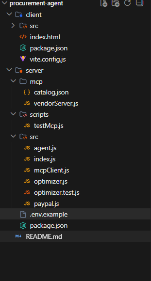

# Agentic Procurement Buyer

An AI-powered procurement agent for the PayPal AI Hackathon 2026. This project demonstrates a human-in-the-loop procurement system that uses LLMs for natural language understanding, MCP (Model Context Protocol) for vendor catalog integration, deterministic optimization for budget selection, and PayPal Sandbox for secure payments.

## Architecture

```
┌─────────────────────────────────────────────────────────────────────────────┐
│                              React Frontend                                 │
│  ┌──────────────┐  ┌──────────────┐  ┌──────────────┐  ┌──────────────┐  │
│  │ Command Input│  │ AG Grid      │  │ Summary Card │  │ Order History│  │
│  │ + Sample Data│  │ Table        │  │ + Why This? │  │ Grid         │  │
│  └──────────────┘  └──────────────┘  └──────────────┘  └──────────────┘  │
└─────────────────────────────────────────────────────────────────────────────┘
                                    │
                                    │ HTTP (REST API)
                                    ▼
┌─────────────────────────────────────────────────────────────────────────────┐
│                           Express Backend (Node.js)                         │
│  ┌──────────────┐  ┌──────────────┐  ┌──────────────┐  ┌──────────────┐  │
│  │ /api/plan    │  │ /api/checkout│  │ /api/capture │  │ /api/orders  │  │
│  │              │  │              │  │              │  │              │  │
│  │ Agent Logic  │  │ PayPal Order │  │ PayPal Capture│  │ Order History│  │
│  └──────────────┘  └──────────────┘  └──────────────┘  └──────────────┘  │
│         │                  │                  │                  │           │
│         ▼                  │                  │                  │           │
│  ┌──────────────┐         │                  │                  │           │
│  │ Gemini LLM   │         │                  │                  │           │
│  │ (gemini-1.5) │         │                  │                  │           │
│  │ Parse +      │         │                  │                  │           │
│  │ Explain      │         │                  │                  │           │
│  └──────────────┘         │                  │                  │           │
│         │                  │                  │                  │           │
│         ▼                  │                  │                  │           │
│  ┌──────────────┐         │                  │                  │           │
│  │ MCP Client   │         │                  │                  │           │
│  │ (stdio)      │         │                  │                  │           │
│  └──────┬───────┘         │                  │                  │           │
│         │ stdio           │                  │                  │           │
│         ▼                  │                  │                  │           │
│  ┌──────────────┐         │                  │                  │           │
│  │ MCP Server   │         │                  │                  │           │
│  │ (vendorServer)│         │                  │                  │           │
│  │              │         │                  │                  │           │
│  │ Tools:       │         │                  │                  │           │
│  │ - list_vendors│         │                  │                  │           │
│  │ - search_products     │                  │                  │           │
│  │ - get_quote  │         │                  │                  │           │
│  └──────┬───────┘         │                  │                  │           │
│         │                  │                  │                  │           │
│         ▼                  │                  │                  │           │
│  ┌──────────────┐         │                  │                  │           │
│  │ catalog.json │         │                  │                  │           │
│  │ (Mock Data)  │         │                  │                  │           │
│  └──────────────┘         │                  │                  │           │
│                            │                  │                  │           │
└────────────────────────────┼──────────────────┼──────────────────┼───────────┘
                             │                  │                  │
                             ▼                  ▼                  ▼
                    ┌──────────────┐  ┌──────────────┐  ┌──────────────┐
                    │ PayPal       │  │ PayPal       │  │ In-Memory    │
                    │ Sandbox API │  │ Sandbox API │  │ Order Log    │
                    │ (Create)     │  │ (Capture)    │  │              │
                    └──────────────┘  └──────────────┘  └──────────────┘
```

## Project Structure

```
procurement-agent/
├── server/                    # Node.js + Express backend
│   ├── src/
│   │   ├── index.js          # Main server with API endpoints
│   │   ├── paypal.js         # PayPal Orders API v2 integration
│   │   ├── agent.js          # Agent orchestration (LLM parsing, quote gathering)
│   │   ├── optimizer.js      # Deterministic budget optimizer (brute-force)
│   │   ├── optimizer.test.js # Unit tests for optimizer
│   │   └── mcpClient.js      # MCP client for vendor catalogs
│   ├── mcp/
│   │   ├── vendorServer.js   # MCP server exposing vendor tools
│   │   └── catalog.json      # Mock vendor and product data
│   ├── scripts/
│   │   └── testMcp.js        # MCP tool testing script
│   ├── .env.example          # Environment variables template
│   └── package.json
├── client/                    # React + Vite frontend
│   ├── src/
│   │   ├── main.jsx          # React entry point
│   │   ├── App.jsx           # Main app with routing
│   │   └── App.css           # Plain CSS styling
│   ├── index.html
│   ├── vite.config.js
│   └── package.json
└── README.md
```

## How PayPal and MCP Are Used

### PayPal Integration
- **Orders API v2**: Used for creating and capturing payment orders in the PayPal Sandbox environment
- **Server-side validation**: Before creating a PayPal order, the server re-validates all prices and stock from the MCP catalog (not trusting client data)
- **Human-in-the-loop**: The system requires explicit human approval before redirecting to PayPal checkout
- **Order history**: All orders are logged in memory with status tracking (CREATED → COMPLETED)

### MCP (Model Context Protocol)
- **Vendor Server**: A local MCP server (`vendorServer.js`) that exposes tools for querying vendor catalogs
- **Tools exposed**:
  - `list_vendors`: Returns available vendors
  - `search_products`: Searches products by category, price, rating, stock
  - `get_quote`: Gets a quote for a specific SKU with quantity
- **Transport**: Uses stdio (standard input/output) for communication between client and server
- **Client**: The backend acts as an MCP client, spawning the vendor server and calling its tools
- **Mock Data**: Uses `catalog.json` with fictional vendors (TechNova, KeyCraft Supply, OfficeHub) and products

## Setup

### Prerequisites
- Node.js 18+ 
- npm or yarn
- PayPal Developer account (for Sandbox credentials)
- Google Gemini API key (from Google AI Studio)

### Getting PayPal Sandbox Credentials

1. **Create PayPal Developer Account**:
   - Go to https://developer.paypal.com/dashboard/
   - Sign up or log in

2. **Create a Sandbox App**:
   - Navigate to "Apps & Credentials"
   - Click "Create App"
   - Select "Merchant" app type
   - Name your app (e.g., "Procurement Agent")

3. **Get Sandbox Credentials**:
   - In your app settings, find "Sandbox" section
   - Copy the **Client ID** and **Client Secret**
   - Note: The Sandbox Base URL is `https://api-m.sandbox.paypal.com`

4. **Create a Sandbox Buyer Account** (for testing):
   - In PayPal Developer Dashboard, go to "Sandbox" → "Accounts"
   - Create a new "Personal" account
   - Note the email and password for testing payments

### Getting Google Gemini API Key

1. **Go to Google AI Studio**:
   - Navigate to https://aistudio.google.com/app/apikey
   - Sign in with your Google account

2. **Create an API Key**:
   - Click "Create API Key"
   - Name your project (e.g., "Procurement Agent")
   - Copy the generated API key

3. **Note the Model**:
   - The default model is `gemini-1.5-flash`
   - You can also use `gemini-1.5-pro` for higher quality (slower)
   - Set `LLM_MODEL` in your `.env` file to change the model

### Server Setup

1. Navigate to the server directory:
   ```bash
   cd server
   ```

2. Install dependencies:
   ```bash
   npm install
   ```

3. Create `.env` file from `.env.example`:
   ```bash
   cp .env.example .env
   ```

4. Edit `.env` with your credentials:
   ```env
   PAYPAL_CLIENT_ID=your_sandbox_client_id
   PAYPAL_CLIENT_SECRET=your_sandbox_client_secret
   PAYPAL_BASE_URL=https://api-m.sandbox.paypal.com
   LLM_API_KEY=your_gemini_api_key
   LLM_MODEL=gemini-1.5-flash
   APP_BASE_URL=http://localhost:5173
   PORT=3001
   ```

5. Run the server:
   ```bash
   npm run dev
   ```
   
   The server will check for required environment variables on startup and exit with an error if any are missing.

### Client Setup

1. Navigate to the client directory:
   ```bash
   cd client
   ```

2. Install dependencies:
   ```bash
   npm install
   ```

3. Run the client:
   ```bash
   npm run dev
   ```

   The frontend will be available at `http://localhost:5173`

## How to Run

1. **Start the backend** (Terminal 1):
   ```bash
   cd server
   npm run dev
   ```
   Server runs on `http://localhost:3001`

2. **Start the frontend** (Terminal 2):
   ```bash
   cd client
   npm run dev
   ```
   Frontend runs on `http://localhost:5173`

3. **Open browser** to `http://localhost:5173`

4. **Test the flow**:
   - Enter a procurement command (example is prefilled)
   - Optionally check "Use sample data" to skip LLM parsing (for demo without API key)
   - Click "Find Best Bundle"
   - Review the agent activity, selected bundle, and quotes table
   - Click "Show Why This Bundle?" to see alternatives and rejected items
   - Click "Approve & Pay with PayPal" to proceed to checkout
   - Log in with your PayPal Sandbox buyer account
   - Complete the payment
   - View order confirmation and history on success page

## Running Tests

The optimizer has unit tests using Node.js's built-in test runner:

```bash
cd server
npm test
```

Tests cover:
- Normal case selection
- Impossible budget handling
- Shipping-once-per-vendor rule
- Low stock filtering
- Low rating filtering

## API Endpoints

- `GET /api/health` - Health check
- `POST /api/plan` - Process procurement request (parses command, gathers quotes, optimizes)
  - Body: `{ command: string, useSampleData?: boolean }`
  - Returns: `{ parsed, quotes, plan, explanation, steps }`
- `POST /api/checkout` - Validate plan and create PayPal order
  - Body: `{ plan }`
  - Returns: `{ approveUrl, orderId }`
- `POST /api/capture/:orderId` - Capture PayPal payment
  - Returns: PayPal capture result
- `GET /api/orders` - Get order history
  - Returns: Array of order records

## Features

- **Natural Language Processing**: LLM parses user commands into structured procurement requests
- **Deterministic Optimization**: Brute-force algorithm finds best bundle under budget (no LLM involved in selection)
- **MCP Integration**: Vendor catalogs exposed via MCP protocol for modularity
- **Server-side Validation**: Prices and stock re-validated from catalog before payment
- **Human-in-the-Loop**: Explicit approval required before payment
- **AG Grid Table**: Sortable, filterable, groupable table with row highlighting and CSV export
- **Sample Data Mode**: Demo mode that skips LLM parsing for testing without API keys
- **Order History**: In-memory log of all orders with status tracking
- **Error Handling**: Clear error messages for LLM, MCP, and PayPal failures
- **Startup Checks**: Validates required environment variables on server start

## Environment Variables

| Variable | Description | Required |
|----------|-------------|----------|
| `PAYPAL_CLIENT_ID` | PayPal Sandbox client ID | Yes |
| `PAYPAL_CLIENT_SECRET` | PayPal Sandbox client secret | Yes |
| `PAYPAL_BASE_URL` | PayPal API base URL (Sandbox) | Yes |
| `LLM_API_KEY` | Google Gemini API key (from AI Studio) | Yes |
| `LLM_MODEL` | Gemini model to use (default: gemini-1.5-flash) | No |
| `APP_BASE_URL` | Frontend URL for CORS | Yes |
| `PORT` | Server port (default: 3001) | No |

## License

MIT
